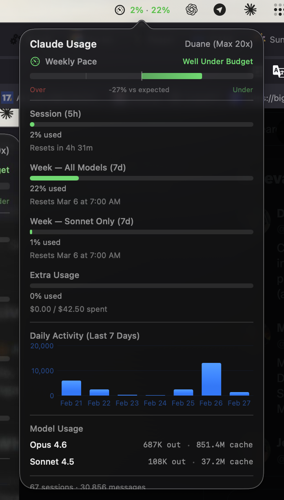

# Claude Usage Widget

A native macOS menu bar app that shows your Claude subscription usage limits in real-time. Mirrors the data from Claude Code's `/usage` command but always visible in your menu bar.

Built for Claude Max subscribers who want to keep an eye on session limits, weekly quotas, extra usage spending, and daily activity — without switching context.

**[Changelog](CHANGELOG.md)** · **[Latest Release](https://github.com/duanestorey/claude-monitor/releases/latest)**



## What It Shows

- **Weekly Pace Gauge** — are you ahead or behind your expected usage rate for the week? Green means you have room to sprint, red means slow down.
- **Session Limit (5h)** — current session utilization with time until reset
- **Weekly Limit (7d)** — all-model and Sonnet-only weekly utilization
- **Extra Usage** — dollar amount spent vs monthly limit
- **Daily Activity Chart** — messages per day over the last 7 calendar days (Swift Charts)
- **Model Usage Breakdown** — output tokens and cache usage per model (Opus, Sonnet, Haiku), with names read from the model IDs
- **Session & Message Totals** — computed from your local Claude Code session history

The menu bar icon is a gauge that reflects your most-constrained limit. Optionally display session %, week %, or both as colored text next to the icon — green under 70%, orange 70-90%, red above 90%.

## Notifications

Configurable macOS notifications when usage crosses thresholds:
- Session limit (default: 80%)
- Weekly limit (default: 75%)
- Extra usage (default: 75%)

Each can be toggled independently with a custom threshold.

## Requirements

- macOS 13.0+
- An active [Claude Code](https://claude.ai/code) session (the app reads your OAuth credentials from `~/.claude/.credentials.json` or the macOS Keychain)

## Install

### Download a Release (no build needed)

1. Download `ClaudeUsageWidget-vX.Y.Z.zip` from the [latest release](https://github.com/duanestorey/claude-monitor/releases/latest)
2. Unzip it and drag `ClaudeUsageWidget.app` to `/Applications`
3. Open it. The app isn't notarized by Apple, so macOS will block the first launch. Go to **System Settings > Privacy & Security**, scroll down, and click **Open Anyway**. Or run this once in Terminal:
   ```bash
   xattr -dr com.apple.quarantine /Applications/ClaudeUsageWidget.app
   ```

Release builds are universal (Apple Silicon and Intel) and need macOS 13.0+.

## Build from Source

Building requires Xcode 15.0+ (with command line tools) and [XcodeGen](https://github.com/yonaskolb/XcodeGen) (`brew install xcodegen`).

### Option A: Command Line

```bash
# Clone the repo
git clone https://github.com/duanestorey/claude-monitor.git
cd claude-monitor

# Install XcodeGen if you don't have it
brew install xcodegen

# Generate the Xcode project
xcodegen generate

# Build the release binary into ./build (gitignored)
xcodebuild -scheme ClaudeUsageWidget -configuration Release -derivedDataPath build build

# Copy to Applications
cp -R build/Build/Products/Release/ClaudeUsageWidget.app /Applications/

# Launch
open /Applications/ClaudeUsageWidget.app
```

No Apple Developer account is needed. The app is ad-hoc signed and runs on the Mac that built it.

### Updating

```bash
cd claude-monitor
git pull
xcodegen generate
xcodebuild -scheme ClaudeUsageWidget -configuration Release -derivedDataPath build build

# Quit the running copy and replace it
pkill -x ClaudeUsageWidget
rm -rf /Applications/ClaudeUsageWidget.app
cp -R build/Build/Products/Release/ClaudeUsageWidget.app /Applications/
open /Applications/ClaudeUsageWidget.app
```

### Option B: Xcode GUI

```bash
# Clone and generate the project
git clone https://github.com/duanestorey/claude-monitor.git
cd claude-monitor
brew install xcodegen
xcodegen generate
```

Then open `ClaudeUsageWidget.xcodeproj` in Xcode, select the **ClaudeUsageWidget** scheme, set the build configuration to **Release**, and hit **Cmd+R** to build and run. To install permanently, use **Product > Archive** or copy the built `.app` from Xcode's DerivedData to `/Applications`.

### First Launch

The app appears as a gauge icon in your menu bar with no Dock icon. Click the gauge to open the usage popover. Click anywhere outside to dismiss.

**Important:** You must have logged into [Claude Code](https://docs.anthropic.com/en/docs/claude-code) at least once before launching this app. The app reads your existing OAuth credentials from `~/.claude/.credentials.json` or, if that file doesn't exist, the macOS Keychain. It doesn't handle login itself. If macOS asks to let the app read the `Claude Code-credentials` Keychain item, click **Always Allow**. You may be asked again after rebuilding, because each build gets a new ad-hoc signature.

The activity chart and model usage come from Claude Code's local session history in `~/.claude/projects/`, so they only cover Claude Code use on this Mac.

## Settings

Click the gear icon in the popover footer to open settings:

- **Refresh interval** — how often to poll the API (1, 2, 5, 10, or 15 minutes)
- **Menu bar display** — icon only, session %, week %, or both
- **Notification thresholds** — toggle and configure alerts for session, weekly, and extra usage limits
- **Launch at login** — start automatically (requires the app to be in `/Applications`)

## How It Works

The app reads your Claude Code OAuth token from `~/.claude/.credentials.json` (preferred) or the macOS Keychain (`Claude Code-credentials` entry) and uses it to query two Anthropic API endpoints:

- `GET /api/oauth/usage` — session and weekly utilization percentages, extra usage credits
- `GET /api/oauth/profile` — account name, email, plan type

Local stats (daily activity, per-model token usage, session and message totals) are computed from Claude Code's session transcripts in `~/.claude/projects/`. The app watches that folder and re-reads only transcripts that changed, so the chart updates within a few seconds of using Claude Code. Claude Code deletes transcripts older than 30 days by default (`cleanupPeriodDays`), so these stats cover that window rather than all time.

The app is **not sandboxed** because it needs to read Claude Code's Keychain entry. It only makes outbound HTTPS requests to `api.anthropic.com`. No data is stored or transmitted anywhere else.

## Architecture

Zero third-party dependencies. Pure Swift using SwiftUI, AppKit, Combine, Charts, and Foundation.

| Component | Role |
|-----------|------|
| `AppDelegate` | Owns `NSStatusItem` + `NSPopover`, updates menu bar icon/text reactively |
| `UsageViewModel` | Polls API, manages state, handles errors and backoff |
| `KeychainService` | Reads OAuth token from credentials file or Keychain |
| `AnthropicAPIClient` | Async URLSession calls with 401 retry and 429 backoff |
| `TranscriptStatsReader` | Aggregates local stats from Claude Code transcripts, watched with FSEvents |
| `NotificationService` | Fires macOS notifications at configurable thresholds |

## Troubleshooting

| Problem | Fix |
|---------|-----|
| `xcodegen: command not found` | Run `brew install xcodegen` |
| Build fails with "no scheme" | Run `xcodegen generate` — the `.xcodeproj` is generated from `project.yml` and may be out of date |
| Gauge shows "No Token" | Make sure you've logged into Claude Code at least once (`claude` in your terminal) |
| Gauge shows "Auth Error" | Your OAuth token may have expired — open Claude Code to refresh it, then relaunch the app |
| Activity chart or model usage is empty | These come from `~/.claude/projects/*.jsonl`. They'll fill in once you've used Claude Code on this Mac in the last 30 days |
| macOS blocks the app | Go to **System Settings > Privacy & Security** and click **Open Anyway** |
| No Keychain access prompt | The app reads `~/.claude/.credentials.json` first; if that's missing, it falls back to the Keychain via the `security` CLI. Ensure Claude Code's credentials exist in one of these locations |

## License

MIT
